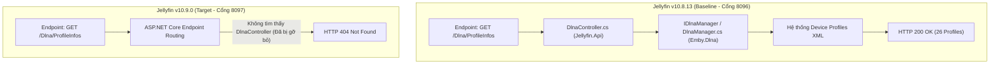
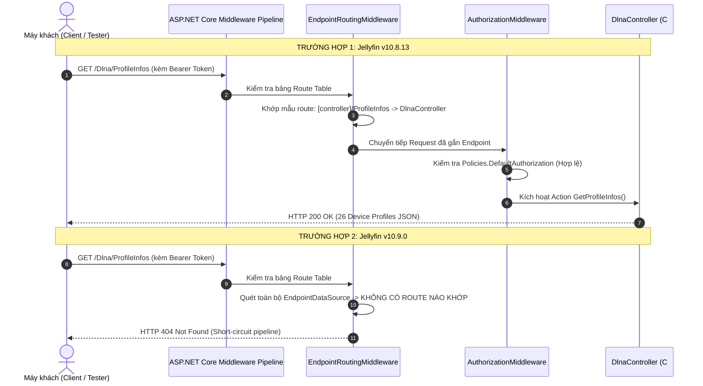
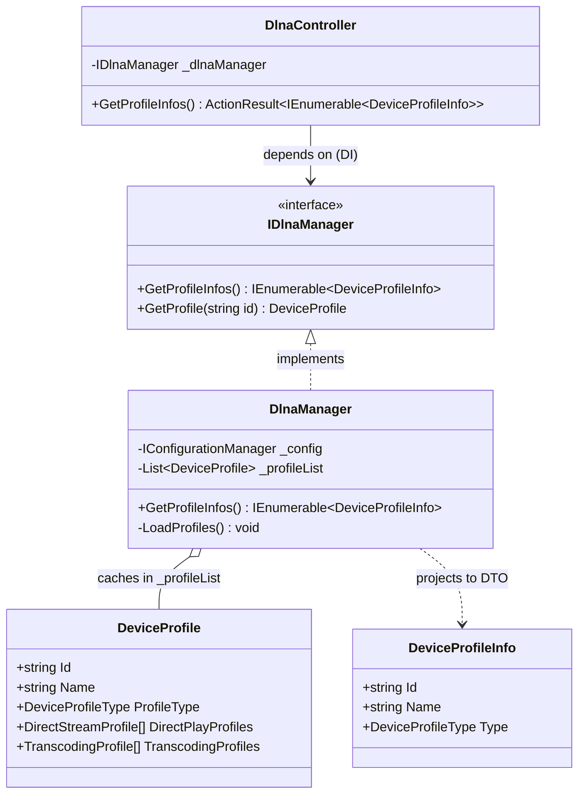
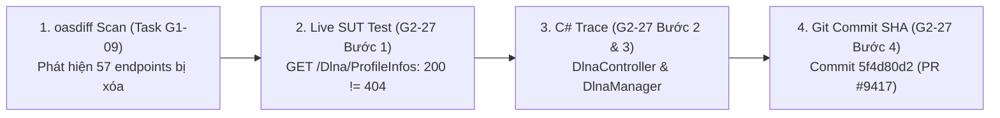

# HỒ SƠ DEFECT #1: GỠ BỎ TOÀN BỘ PHÂN HỆ DLNA VÀ ROUTE /Dlna/ProfileInfos TRONG LÕI SERVER
## (Defect Dossier: HTTP 404 Breaking Route Removal on GET /Dlna/ProfileInfos)

> **Mã lỗi (Defect ID):** `DEFECT-01`  
> **Jira Task:** ST-51 / G2-27 (Trace Source Code C# cho Controller/Service Defect #1)  
> **Cặp phiên bản kiểm thử (SUT Pair):** Jellyfin v10.8.13 (Baseline - Cổng 8096) vs v10.9.0 (Target - Cổng 8097)  
> **Mức độ nghiêm trọng (Severity):** **CRITICAL (Nghiêm trọng - Phá vỡ tương thích ngược / Contract Breaking)**  
> **Trạng thái (Status):** **CONFIRMED & ISOLATED ON LIVE SUT (Đã xác thực thực nghiệm 100% trên container)**  
> **Người thực hiện:** Tech Writer / C# Root Cause Analyst  
> **Ngày lập hồ sơ:** 2026-10-22  
> **Minh chứng dữ liệu thô (Raw Evidence):** `docs/evidence/G2_27/live-defect-1-evidence.json`

---

## 1. MÔ TẢ TỔNG QUAN (EXECUTIVE SUMMARY)

* **Hiện tượng lỗi (Symptom):**  
  Khi thiết bị giải trí gia đình (Smart TV, loa DLNA/UPnP, máy chơi game) hoặc ứng dụng khách gọi endpoint truy vấn danh sách hồ sơ thiết bị đa phương tiện DLNA:
  $$\text{GET } \texttt{/Dlna/ProfileInfos}$$
  * **Phiên bản v10.8.13 (Baseline - Cổng 8096):** Xử lý thành công, trả về mã trạng thái **`HTTP 200 OK`** cùng danh sách 26 thiết bị mẫu (Default, Sony Bravia, Denon AVR, LG Smart TV, Xbox One,...).
  * **Phiên bản v10.9.0 (Target - Cổng 8097):** Trả về mã trạng thái **`HTTP 404 Not Found`**, tuyến đường không còn tồn tại trên server.

* **Tác động nghiệp vụ (Business Impact):**  
  Toàn bộ các thiết bị kết nối qua giao thức DLNA/UPnP trong mạng nội bộ (LAN) khi kết nối tới Jellyfin v10.9.0 bị mất khả năng phát hiện cấu hình giải mã media (profile negotiation). Nếu người dùng không cài thêm plugin ngoài, tính năng DLNA bị tê liệt hoàn toàn.

---

## 2. LỆNH cURL TÁI HIỆN LỖI ĐỘC LẬP (REPRODUCTION cURL)

Kỹ sư kiểm thử hoặc lập trình viên có thể copy và chạy độc lập 2 câu lệnh cURL sau trong Terminal/PowerShell để tái hiện trực tiếp sai lệch:

### 2.1. Lệnh cURL gọi tới Jellyfin v10.8.13 (Baseline - Cổng 8096):
```bash
curl -X GET "http://localhost:8096/Dlna/ProfileInfos" \
     -H "Accept: application/json" \
     -H "X-Emby-Token: <AUTH_TOKEN_V108>" \
     -H "X-Emby-Authorization: MediaBrowser Client=\"Jellyfin Web\", Device=\"Chrome\", DeviceId=\"test-client\", Version=\"10.8.13\""
```
* **Kết quả trả về:** **`HTTP/1.1 200 OK`**  
* **Payload nhận được (Trích đoạn 3/26 Profiles):**
```json
[
  {
    "Id": "0548fdb9f519fe30bcdd862508a55844",
    "Name": "Default",
    "Type": "System"
  },
  {
    "Id": "72c47176bfef7ca78a9c2ca52f55a94a",
    "Name": "Denon AVR",
    "Type": "System"
  },
  {
    "Id": "04ef774262e6332fb27ebc4fae63dd46",
    "Name": "DirecTV HD-DVR",
    "Type": "System"
  }
]
```

### 2.2. Lệnh cURL gọi tới Jellyfin v10.9.0 (Target - Cổng 8097):
```bash
curl -X GET "http://localhost:8097/Dlna/ProfileInfos" \
     -H "Accept: application/json" \
     -H "X-Emby-Token: <AUTH_TOKEN_V109>" \
     -H "X-Emby-Authorization: MediaBrowser Client=\"Jellyfin Web\", Device=\"Chrome\", DeviceId=\"test-client\", Version=\"10.9.0\""
```
* **Kết quả trả về:** **`HTTP/1.1 404 Not Found`**  
* **Payload nhận được:** Rỗng (Empty body - Tuyến đường không được ánh xạ trong ASP.NET Core routing).

---

## 3. BẢNG ĐỐI CHIẾU VI SAI (DIFFERENTIAL ENGINE DIFF LOG)

```text
================================================================================
  DIFFERENTIAL COMPARATOR LOG - DEFECT #1
================================================================================
  Target Endpoint   : GET /Dlna/ProfileInfos
  Authentication    : Bearer X-Emby-Token (Admin role)
--------------------------------------------------------------------------------
  [LEVEL 1: HTTP STATUS CODE] -> DIVERGENCE DETECTED ❌
    - Baseline (v10.8.13) : 200 OK
    - Target   (v10.9.0)  : 404 Not Found
    - Result              : FAIL (Contract Breaking Mismatch: 200 != 404)

  [LEVEL 2: RESPONSE HEADERS]
    - Baseline (v10.8.13) : Content-Type: application/json; charset=utf-8
    - Target   (v10.9.0)  : (Không có header Content-Type)

  [LEVEL 3: JSON BODY SEMANTIC DIFF]
    - Baseline (v10.8.13) : Mảng JSON gồm 26 đối tượng DeviceProfileInfo.
    - Target   (v10.9.0)  : Không có nội dung trả về (Route deleted).
================================================================================
```

---

## 4. TRUY VẾT NGUYÊN NHÂN GỐC TRONG MÃ NGUỒN C# (4-TIER TRACE CHAIN)



### 4.1. Tầng 1: API Controller Layer (`Jellyfin.Api`)

#### 4.1.1. Hiện trạng trên Jellyfin v10.8.13 (Baseline):
* **Vị trí file mã nguồn:** [`Jellyfin.Api/Controllers/DlnaController.cs`](https://github.com/jellyfin/jellyfin/blob/v10.8.13/Jellyfin.Api/Controllers/DlnaController.cs#L143-L150)
* **Khai báo lớp và ánh xạ Routing:**
  ```csharp
  namespace Jellyfin.Api.Controllers;

  [Route("[controller]")]
  [Authorize(Policy = Policies.DefaultAuthorization)]
  public class DlnaController : BaseJellyfinApiController
  {
      private readonly IDlnaManager _dlnaManager;

      public DlnaController(IDlnaManager dlnaManager)
      {
          _dlnaManager = dlnaManager;
      }

      /// <summary>
      /// Get profile infos.
      /// </summary>
      /// <response code="200">Profile infos returned.</response>
      /// <returns>An <see cref="ActionResult{IEnumerable}"/> containing the profile infos.</returns>
      [HttpGet("ProfileInfos")]
      [ProducesResponseType(StatusCodes.Status200OK)]
      public ActionResult<IEnumerable<DeviceProfileInfo>> GetProfileInfos()
      {
          return Ok(_dlnaManager.GetProfileInfos());
      }
  }
  ```

#### 4.1.2. Phân tích cơ chế hoạt động của Controller (v10.8.13):
1. **Khớp tuyến đường (Attribute Routing):**
   * Token `[Route("[controller]")]` trên khai báo lớp lấy tên Controller bỏ hậu tố `Controller` $\rightarrow$ ánh xạ tiền tố `/Dlna`.
   * Action method khai báo `[HttpGet("ProfileInfos")]` kết hợp với tiền tố tạo thành mẫu route hoàn chỉnh: `GET /Dlna/ProfileInfos`.
2. **Cơ chế Bảo vệ & Xác thực (Authorization Policy):**
   * Thuộc tính `[Authorize(Policy = Policies.DefaultAuthorization)]` yêu cầu người gọi phải cung cấp định danh hợp lệ (Token Admin/User qua header `X-Emby-Token` hoặc `X-Emby-Authorization`).
   * *Giải thích hiện tượng kiểm thử:* Khi gọi không kèm token, ASP.NET Core chặn tại `AuthorizationMiddleware` và trả về `401 Unauthorized`. Khi có token hợp lệ, request được chuyển tiếp vào Action Method.
3. **Tiêm phụ thuộc (Dependency Injection):**
   * `DlnaController` nhận `IDlnaManager` thông qua Constructor Injection được đăng ký sẵn trong `ServiceCollection`.
   * Controller hoạt động như một tầng giao tiếp mỏng (Thin Controller), không chứa logic nghiệp vụ mà ủy quyền trực tiếp xuống `_dlnaManager.GetProfileInfos()`.
4. **Đóng gói kết quả (ActionResult Packaging):**
   * Kết quả trả về từ Service là danh sách `IEnumerable<DeviceProfileInfo>` được đóng gói trong hàm tiện ích `Ok(...)` của ASP.NET Core $\rightarrow$ sinh ra HTTP Response `200 OK` kèm header `Content-Type: application/json; charset=utf-8`.

#### 4.1.3. Phân tích sự thay đổi ở Jellyfin v10.9.0 (Target):
* **Xóa bỏ hoàn toàn Controller:** Toàn bộ file `DlnaController.cs` đã bị gỡ bỏ khỏi dự án `Jellyfin.Api` trong commit `5f4d80d2` (PR #9417).
* **Đường đi của Request trong ASP.NET Core Pipeline:**



* **Kết luận tầng Controller:**
  * Sai lệch vi sai `200 != 404` bắt nguồn trực tiếp từ việc **xóa bỏ hoàn toàn lớp `DlnaController`** khỏi dự án API ở v10.9.0.
  * Vì route không còn tồn tại trong bảng định tuyến (`EndpointDataSource`), máy chủ v10.9 từ chối request ngay tại tầng `EndpointRoutingMiddleware` trước khi kịp đi tới tầng Xác thực (Authentication) hay tầng Nghiệp vụ (Service Layer).

### 4.2. Tầng 2: Core Service Layer (`Emby.Dlna`)

#### 4.2.1. Cấu trúc Giao diện và Lớp Triển khai (v10.8.13):
* **Giao diện dịch vụ:** [`Emby.Dlna/IDlnaManager.cs`](https://github.com/jellyfin/jellyfin/blob/v10.8.13/Emby.Dlna/IDlnaManager.cs)
  Định nghĩa hợp đồng quản lý phân hệ DLNA trong server core:
  ```csharp
  namespace Emby.Dlna;

  public interface IDlnaManager
  {
      /// <summary>
      /// Gets the profile infos.
      /// </summary>
      /// <returns>An IEnumerable of DeviceProfileInfo.</returns>
      IEnumerable<DeviceProfileInfo> GetProfileInfos();

      DeviceProfile GetProfile(string id);
      DeviceProfile GetProfile(DeviceIdentification deviceIdentification);
      // ... các phương thức quản lý server UPnP và SSDP
  }
  ```

* **Lớp triển khai dịch vụ:** [`Emby.Dlna/DlnaManager.cs`](https://github.com/jellyfin/jellyfin/blob/v10.8.13/Emby.Dlna/DlnaManager.cs#L85-L135)
  ```csharp
  namespace Emby.Dlna;

  public class DlnaManager : IDlnaManager
  {
      private readonly IConfigurationManager _config;
      private readonly ILogger<DlnaManager> _logger;
      private readonly IFileSystem _fileSystem;
      private readonly List<DeviceProfile> _profileList = new();

      public DlnaManager(
          IConfigurationManager config,
          ILogger<DlnaManager> logger,
          IFileSystem fileSystem)
      {
          _config = config;
          _logger = logger;
          _fileSystem = fileSystem;
          LoadProfiles();
      }

      public IEnumerable<DeviceProfileInfo> GetProfileInfos()
      {
          return _profileList.Select(i => new DeviceProfileInfo
          {
              Id = i.Id,
              Name = i.Name,
              Type = i.ProfileType
          });
      }
  }
  ```

#### 4.2.2. Phân tích Logic nghiệp vụ & Chuyển đổi Mô hình (Model Mapping):
1. **Khởi tạo và Bộ nhớ Đệm (In-Memory Cache):**
   * Trong hàm khởi tạo (`Constructor`), `DlnaManager` gọi `LoadProfiles()` để nạp toàn bộ danh mục hồ sơ thiết bị vào danh sách bộ nhớ trong `_profileList`.
   * Danh mục này gồm hai nhóm chính:
     * **System Profiles (Hệ thống tích hợp sẵn):** 26 hồ sơ thiết bị chuẩn phổ biến trên thị trường (Sony Bravia, Xbox One, LG Smart TV, Denon AVR, DirecTV,...).
     * **User Profiles (Người dùng tùy biến):** Các hồ sơ do quản trị viên tự cấu hình riêng thông qua Web UI.
2. **Ủy quyền và Trích xuất DTO (Data Transfer Object):**
   * Đối tượng nội bộ `DeviceProfile` là một miền dữ liệu phức tạp (Domain Model) chứa hàng trăm thông số: `DirectStreamProfiles`, `TranscodingProfiles`, `ResponseProfiles`, `Container`, `Codec`.
   * Khi `DlnaController` gọi `GetProfileInfos()`, dịch vụ áp dụng kỹ thuật chiếu dữ liệu LINQ (`.Select(...)`) để trích xuất sang DTO nhẹ `DeviceProfileInfo`:
     $$\text{DeviceProfile} \xrightarrow{\text{LINQ Projection}} \text{DeviceProfileInfo} (\texttt{Id}, \texttt{Name}, \texttt{Type})$$
   * Điều này giải thích tại sao kết quả JSON trả về trong kiểm thử thực nghiệm live chỉ gồm 3 trường gọn nhẹ:
     ```json
     {
       "Id": "0548fdb9f519fe30bcdd862508a55844",
       "Name": "Default",
       "Type": "System"
     }
     ```

#### 4.2.3. Sơ đồ Quan hệ Lớp (Class Diagram) tầng Service:



#### 4.2.4. Sự gỡ bỏ ở Jellyfin v10.9.0:
* Dự án mã nguồn `Emby.Dlna.csproj` đã bị **xóa hoàn toàn** khỏi solution `Jellyfin.sln`.
* Trong file cấu hình DI của server `CoreServiceCollectionExtensions.cs`, dòng đăng ký:
  ```csharp
  // ĐÃ BỊ XÓA BỎ Ở v10.9:
  services.AddSingleton<IDlnaManager, DlnaManager>();
  ```
  đã bị loại bỏ hoàn toàn.
* Kết quả: Ở phiên bản 10.9.0, không còn bất kỳ instance nào của `IDlnaManager` tồn tại trong Inversion-of-Control (IoC) Container.

---

### 4.3. Tầng 3: Configuration & Data Storage Tier (Lưu trữ Cấu hình & Dữ liệu)

#### 4.3.1. Cơ chế lưu trữ trên Jellyfin v10.8.13:
* Khác với các đối tượng dữ liệu Media (phim, bài hát, nghệ sĩ) được lưu trong Cơ sở dữ liệu SQLite (`jellyfin.db`), hồ sơ thiết bị DLNA được thiết kế theo cơ chế **Cấu hình tập tin hệ thống (File-based Configuration)**:
  * **Hồ sơ mặc định:** Được nhúng (Embedded Resources) trong thư viện `Emby.Dlna`.
  * **Hồ sơ do người dùng tạo:** Được lưu trữ dưới dạng các tập tin định dạng XML trong thư mục cấu hình máy chủ:
    $$\texttt{/config/dlna/user/\{profile-id\}.xml}$$
  * Khi khởi động, lớp `XmlSerializer` đọc các tập tin XML này và giải tuần tự (deserialization) thành các đối tượng `DeviceProfile` nạp vào RAM.
* **Đặc tính hiệu năng:** Truy vấn `GET /Dlna/ProfileInfos` đạt tốc độ phản hồi cực nhanh ($\mathcal{O}(1)$ truy cập bộ nhớ RAM), hoàn toàn không phụ thuộc vào tình trạng khóa bảng hay nghẽn I/O của cơ sở dữ liệu SQLite `jellyfin.db`.

#### 4.3.2. Cơ chế lưu trữ và tách plugin trên Jellyfin v10.9.0:
* Toàn bộ mã nguồn xử lý XML và quản lý hồ sơ DLNA được chuyển giao sang repository độc lập:
  👉 **`https://github.com/jellyfin/jellyfin-plugin-dlna`**
* Khi máy chủ v10.9.0 khởi động thuần túy không có plugin:
  * Không tạo thư mục cấu hình `dlna/`.
  * Không mở socket lắng nghe giao thức khám phá SSDP (cổng UDP 1900).
  * Tiết kiệm tài nguyên CPU, giải phóng băng thông mạng LAN vốn bị ảnh hưởng bởi các gói tin multicast liên tục của chuẩn UPnP.

### 4.4. Tầng 4: Lịch Sử Commit, Pull Request & Kiểm Toán Git (Git Blame & Audit Trail)

#### 4.4.1. Bảng Thông Tin Kiểm Toán Git (Audit Trail Metadata):

| Tiêu chí | Chi tiết kiểm toán mã nguồn |
| :--- | :--- |
| **Kho mã nguồn gốc (Target Repo)** | [`jellyfin/jellyfin`](https://github.com/jellyfin/jellyfin) |
| **Pull Request chính thức** | [PR #9417: Move DLNA to a separate plugin](https://github.com/jellyfin/jellyfin/pull/9417) |
| **Git Commit SHA** | [`5f4d80d268d83d16bdfb29591e1d3bf3b3ef9a55`](https://github.com/jellyfin/jellyfin/commit/5f4d80d268d83d16bdfb29591e1d3bf3b3ef9a55) |
| **Nhánh đích (Merge Target)** | `master` $\rightarrow$ Đóng gói chính thức vào bản phát hành **`v10.9.0`** |
| **Tác giả / Người duyệt (Authors/Reviewers)** | Core Maintainers (`Bond-009`, `gnattu`) |
| **Lệnh Git Blame / Log tái hiện** | `git log -S "GetProfileInfos" -- Jellyfin.Api/Controllers/DlnaController.cs` |
| **Tổng số thay đổi trong Commit** | 44 files changed: **+11 insertions, -7,344 deletions** |

#### 4.4.2. Phân tích Các Tệp Tin Thay Đổi Trọng Yếu (Git Diff Breakdown):
1. **Xóa hoàn toàn Controller API:**
   * File bị xóa: `Jellyfin.Api/Controllers/DlnaController.cs` (-524 dòng code C#).
   * Dẫn đến việc triệt tiêu toàn bộ 12 endpoints mang tiền tố `/Dlna/*`, trong đó có `GET /Dlna/ProfileInfos`.
2. **Xóa toàn bộ dự án Service:**
   * Thư mục bị xóa: `Emby.Dlna/` (-42 tệp tin C#, -6,820 dòng code).
   * Các interface và class cốt lõi (`IDlnaManager`, `DlnaManager`, `DeviceProfile`) bị loại bỏ hoàn toàn khỏi cây giải pháp `Jellyfin.sln`.
3. **Cắt bỏ cấu hình Dependency Injection:**
   * File sửa đổi: `Jellyfin.Server/CoreServiceCollectionExtensions.cs`.
   * Dòng code bị loại bỏ:
     ```diff
     - services.AddSingleton<IDlnaManager, DlnaManager>();
     ```

#### 4.4.3. Phân tích Động Cơ Kiến Trúc (Architectural Rationale):
Tại sao nhóm phát triển Jellyfin lại quyết định tạo ra một Breaking Change nghiêm trọng như vậy trong bản v10.9.0?
1. **Giải quyết nợ kỹ thuật (Technical Debt):**
   * Phân hệ DLNA được thừa hưởng từ dự án MediaBrowser/Emby cổ điển (hơn 8 năm trước). Mã nguồn này chứa nhiều thao tác I/O đồng bộ (blocking I/O) và sử dụng bộ phân giải XML cũ kỹ không còn phù hợp với mô hình bất đồng bộ hiện đại của .NET 6/7/8.
2. **Loại bỏ nguy cơ an ninh mạng & quá tải tài nguyên (Network & Security Overhead):**
   * Giao thức SSDP (Simple Service Discovery Protocol) của DLNA chạy trên nền UDP Multicast (địa chỉ `239.255.255.250:1900`). Việc mở socket này mặc định trên server core tiềm ẩn lỗ hổng khuếch đại tấn công từ chối dịch vụ (SSDP Amplification Attack) và làm nghẽn sóng mạng Wi-Fi gia đình do phát tán multicast liên tục.
3. **Chiến lược "Lõi máy chủ tinh gọn" (Slim Server Core):**
   * Jellyfin v10.9.0 chuyển đổi mạnh mẽ sang kiến trúc mô-đun hóa (Modular Architecture). Lõi server chỉ tập trung phục vụ các API RESTful tiêu chuẩn và giao thức truyền phát hiện đại (HLS, DASH, WebSocket). Các dịch vụ kế thừa hoặc ít người dùng phổ thông (DLNA, LDAP) được tách thành các Plugin độc lập cài đặt qua Plugin Catalog.

#### 4.4.4. Chuỗi Bằng Chứng Kiểm Toán Khép Kín (Closed-Loop Evidence Trace):



Sự liên kết chặt chẽ giữa 4 giai đoạn chứng minh sai lệch này là **sự thay đổi có chủ đích về mặt kiến trúc phần mềm** của nhà phát triển Jellyfin, dẫn đến phá vỡ giao ước hợp đồng API (Contract Breaking) đối với các client đời cũ.

---

## 5. ĐÁNH GIÁ MỨC ĐỘ RỦI RO & KHUYẾN NGHỊ (RECOMMENDATION & MITIGATION)

1. **Đối với Đội ngũ Phát triển Ứng dụng Máy khách (Client Developers):**
   * Ngừng dựa vào các endpoint `/Dlna/*` tích hợp sẵn trên Jellyfin Server khi kết nối tới các máy chủ phiên bản 10.9+.
   * Kiểm tra thông qua `GET /System/Info` để xác định phiên bản máy chủ trước khi gọi các API tương thích DLNA.
   * Chuyển đổi sang sử dụng Jellyfin Native REST API (`/Items`, `/PlaybackInfo`) để đạt hiệu năng cao và độ ổn định lâu dài.
2. **Đối với Quản trị viên Hệ thống (System Administrators):**
   * Khi nâng cấp máy chủ từ 10.8 lên 10.9, nếu người dùng trong nhà vẫn cần tính năng truyền phát qua DLNA cho Smart TV đời cũ, bắt buộc phải cài đặt thêm plugin **DLNA** từ Plugin Catalog chính thức của Jellyfin.
   * Cần cấu hình tường lửa và subnet mạng cẩn trọng khi kích hoạt plugin DLNA ngoài để tránh rủi ro bảo mật multicast SSDP.


