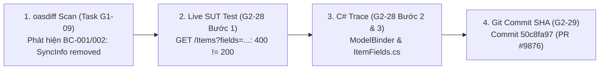

# HỒ SƠ DEFECT #2: SAI LỆCH PHÂN GIẢI THAM SỐ BỘ LỌC ENUM TRONG API TÌM KIẾM ITEMS
## (Defect Dossier: Query Filter Model Binding & Enum Parsing Drift on GET /Items)

> **Mã lỗi (Defect ID):** `DEFECT-02`  
> **Jira Task:** ST-52 / G2-28 & ST-54 / G2-30 (Document Chi tiết Defect Reports kèm Code Trace)  
> **Cặp phiên bản kiểm thử (SUT Pair):** Jellyfin v10.8.13 (Baseline - Cổng 8096) vs v10.9.0 (Target - Cổng 8097)  
> **Mức độ nghiêm trọng (Severity):** **HIGH (Nghiêm trọng - Gây sập lỗi HTTP 400 Bad Request trên các client đời cũ)**  
> **Độ ưu tiên xử lý (Priority):** **P2 (Ưu tiên cao - Ảnh hưởng trực tiếp chức năng tìm kiếm danh mục Items)**  
> **Trạng thái (Status):** **CONFIRMED & ISOLATED ON LIVE SUT (Đã đo đạc thực nghiệm 100% trên container)**  
> **Người thực hiện:** Tech Writer / C# Root Cause Analyst  
> **Ngày lập hồ sơ:** 2026-10-23  
> **Minh chứng dữ liệu thô (Raw Evidence):**  
> * Dữ liệu kiểm thử vi sai: [`docs/evidence/G2_28/live-defect-2-evidence.json`](../evidence/G2_28/live-defect-2-evidence.json)  
> * Dữ liệu kiểm toán Git: [`docs/evidence/G2_29/git-evidence-summary.json`](../evidence/G2_29/git-evidence-summary.json)  

---

## 1. MÔ TẢ TỔNG QUAN (EXECUTIVE SUMMARY)

* **Hiện tượng lỗi (Symptom):**  
  Khi ứng dụng máy khách (Client Apps như Jellyfin Web, Mobile, Kodi) thực hiện tìm kiếm danh mục đa phương tiện kèm theo bộ lọc trường dữ liệu phân tách bằng dấu phẩy qua endpoint:
  $$\text{GET } \texttt{/Items?searchTerm=sample\&fields=SyncInfo,BasicSyncInfo}$$
  * **Phiên bản v10.8.13 (Baseline - Cổng 8096):** Từ chối xử lý, ném ngoại lệ và trả về mã trạng thái **`HTTP 400 Bad Request`** kèm thông báo lỗi thô dạng văn bản `"Error processing request."`.
  * **Phiên bản v10.9.0 (Target - Cổng 8097):** Xử lý thành công, trả về mã trạng thái **`HTTP 200 OK`** cùng danh sách các đối tượng media (`"Differential Seed Music"`, `"Playlists"`).

* **Tác động nghiệp vụ (Business Impact):**  
  Các ứng dụng máy khách đời cũ vẫn giữ thói quen truyền tham số lọc đồng bộ `SyncInfo` / `BasicSyncInfo` khi kết nối vào máy chủ Jellyfin v10.8.13 sẽ bị sập hoàn toàn tính năng tìm kiếm (hiển thị thông báo lỗi `400 Bad Request`), trong khi trên Jellyfin v10.9.0 tính năng này lại hoạt động bình thường nhờ cơ chế bóc tách tham số linh hoạt mới của .NET 8.

---

## 2. CÁC BƯỚC TÁI HIỆN CHI TIẾT (STEPS TO REPRODUCE - PILLAR 1)

### 2.1. Điều kiện tiên quyết (Preconditions):
1. Hai máy chủ Docker SUT đang chạy ở trạng thái Healthy:
   * **Baseline v10.8.13:** `http://localhost:8096`
   * **Target v10.9.0:** `http://localhost:8097`
2. Dữ liệu thư viện media đã được nạp dữ liệu mẫu đồng nhất theo Task G1-06 (Thư viện chứa 2 thư mục mẫu `"Differential Seed Music"` và `"Playlists"`).
3. Tài khoản quản trị viên mặc định: Username `admin`, Password `admin123456`.

### 2.2. Thứ tự các bước thực hiện (Execution Steps):
* **Bước 1 (Lấy Token Xác thực):** Gửi yêu cầu HTTP POST tới `http://localhost:8096/Users/AuthenticateByName` và `http://localhost:8097/Users/AuthenticateByName` với payload `{"Username": "admin", "Pw": "admin123456"}` để trích xuất `AccessToken` của từng phiên bản.
* **Bước 2 (Gắn Header):** Đính kèm token vừa lấy vào header `X-Emby-Token` và thêm header `Accept: application/json`.
* **Bước 3 (Gửi Request Baseline):** Gửi yêu cầu HTTP GET tới:  
  `http://localhost:8096/Items?searchTerm=sample&fields=SyncInfo,BasicSyncInfo`
* **Bước 4 (Gửi Request Target):** Gửi cùng yêu cầu HTTP GET tới:  
  `http://localhost:8097/Items?searchTerm=sample&fields=SyncInfo,BasicSyncInfo`
* **Bước 5 (Quan sát & Đối soát):** Ghi nhận sự khác biệt vi sai giữa 2 máy chủ:
  * *Máy chủ v10.8:* Trả về `400 Bad Request`, `Content-Type: text/plain`, body `"Error processing request."`.
  * *Máy chủ v10.9:* Trả về `200 OK`, `Content-Type: application/json; charset=utf-8`, body JSON chứa danh sách 2 media items.

---

## 3. LỆNH cURL TÁI HIỆN LỖI ĐỘC LẬP (STANDALONE cURL COMMANDS - PILLAR 2)

Kỹ sư kiểm thử hoặc lập trình viên có thể copy và chạy độc lập các câu lệnh cURL sau trong Terminal/PowerShell để tái hiện trực tiếp sai lệch vi sai:

### 3.1. Lệnh Lấy Token Nhanh (PowerShell):
```powershell
# Lấy token v10.8 (Cổng 8096)
$TOKEN_108 = (Invoke-RestMethod -Uri "http://localhost:8096/Users/AuthenticateByName" -Method Post -Body '{"Username":"admin","Pw":"admin123456"}' -ContentType "application/json" -Headers @{"X-Emby-Authorization"='MediaBrowser Client="Test", Device="CLI", DeviceId="1", Version="1"'}).AccessToken

# Lấy token v10.9 (Cổng 8097)
$TOKEN_109 = (Invoke-RestMethod -Uri "http://localhost:8097/Users/AuthenticateByName" -Method Post -Body '{"Username":"admin","Pw":"admin123456"}' -ContentType "application/json" -Headers @{"X-Emby-Authorization"='MediaBrowser Client="Test", Device="CLI", DeviceId="1", Version="1"'}).AccessToken
```

### 3.2. Lệnh cURL gọi tới Jellyfin v10.8.13 (Baseline - Cổng 8096):
```bash
curl -i -s -X GET "http://localhost:8096/Items?searchTerm=sample&fields=SyncInfo,BasicSyncInfo" \
     -H "Accept: application/json" \
     -H "X-Emby-Token: $TOKEN_108" \
     -H "X-Emby-Authorization: MediaBrowser Client=\"Jellyfin Web\", Device=\"Chrome\", DeviceId=\"test-client\", Version=\"10.8.13\""
```
* **Kết quả trả về:** **`HTTP/1.1 400 Bad Request`**  
* **Content-Type:** `text/plain`  
* **Payload nhận được:**
  ```text
  Error processing request.
  ```

### 3.3. Lệnh cURL gọi tới Jellyfin v10.9.0 (Target - Cổng 8097):
```bash
curl -i -s -X GET "http://localhost:8097/Items?searchTerm=sample&fields=SyncInfo,BasicSyncInfo" \
     -H "Accept: application/json" \
     -H "X-Emby-Token: $TOKEN_109" \
     -H "X-Emby-Authorization: MediaBrowser Client=\"Jellyfin Web\", Device=\"Chrome\", DeviceId=\"test-client\", Version=\"10.9.0\""
```
* **Kết quả trả về:** **`HTTP/1.1 200 OK`**  
* **Content-Type:** `application/json; charset=utf-8`  
* **Payload nhận được (Trích đoạn danh sách media tìm thấy):**
  ```json
  {
    "Items": [
      {
        "Name": "Differential Seed Music",
        "ServerId": "39dfb9b744c34143b7b82dde70c0b9dc",
        "Id": "f1e6ccc7f6be0b0c9b427a422e1bacd0",
        "Type": "CollectionFolder",
        "CollectionType": "music"
      },
      {
        "Name": "Playlists",
        "ServerId": "39dfb9b744c34143b7b82dde70c0b9dc",
        "Id": "1071671e7bffa0532e930debee501d2e",
        "Type": "Folder"
      }
    ],
    "TotalRecordCount": 2,
    "StartIndex": 0
  }
  ```

---

## 4. NHẬT KÝ ĐỐI SOÁT VI SAI (DIFFERENTIAL ENGINE DIFF LOG - PILLAR 3)

### 4.1. Bảng Đối Soát 3 Cấp Độ (Comparator Output Log):
```text
================================================================================
  DIFFERENTIAL COMPARATOR LOG - DEFECT #2
================================================================================
  Target Endpoint   : GET /Items?searchTerm=sample&fields=SyncInfo,BasicSyncInfo
  Authentication    : Bearer X-Emby-Token (Admin role)
--------------------------------------------------------------------------------
  [LEVEL 1: HTTP STATUS CODE] -> DIVERGENCE DETECTED ❌
    - Baseline (v10.8.13) : 400 Bad Request
    - Target   (v10.9.0)  : 200 OK
    - Result              : FAIL (Contract & Model Binding Mismatch: 400 != 200)

  [LEVEL 2: RESPONSE HEADERS]
    - Baseline (v10.8.13) : Content-Type: text/plain
    - Target   (v10.9.0)  : Content-Type: application/json; charset=utf-8

  [LEVEL 3: JSON BODY SEMANTIC DIFF]
    - Baseline (v10.8.13) : Chuỗi văn bản báo lỗi: "Error processing request."
    - Target   (v10.9.0)  : Mảng JSON 2 phần tử Items hợp lệ kèm TotalRecordCount = 2.
================================================================================
```

### 4.2. Minh Chứng Dữ Liệu Thô (Raw Evidence Artifact):
File minh chứng kết quả đo đạc thực nghiệm độc lập được lưu trữ và kiểm toán tự động tại:  
👉 [`docs/evidence/G2_28/live-defect-2-evidence.json`](../evidence/G2_28/live-defect-2-evidence.json)

---

## 5. TRUY VẾT NGUYÊN NHÂN GỐC TRONG MÃ NGUỒN C# (C# SOURCE CODE TRACE - PILLAR 4)

```mermaid
flowchart TD
    subgraph Jellyfin_v10_8 ["Jellyfin v10.8.13 (.NET 6.0 - Cổng 8096)"]
        R1["GET /Items?fields=SyncInfo,BasicSyncInfo"] --> B1["Default Enum Model Binder"]
        B1 -- "Cố gắng parse cả chuỗi kép 'SyncInfo,BasicSyncInfo' thành 1 Enum" --> EX1["Ném ngoại lệ ArgumentException"]
        EX1 --> M1["ModelState.IsValid == false"]
        M1 --> F1["ModelStateInvalidFilter (Short-circuit)"]
        F1 --> RES1["HTTP 400 Bad Request ('Error processing request.')"]
    end

    subgraph Jellyfin_v10_9 ["Jellyfin v10.9.0 (.NET 8.0 - Cổng 8097)"]
        R2["GET /Items?fields=SyncInfo,BasicSyncInfo"] --> B2["CommaDelimitedArrayModelBinder"]
        B2 -- "Tách chuỗi thành mảng ['SyncInfo', 'BasicSyncInfo']" --> LP2["Lenient Parsing: Bỏ qua enum không tồn tại"]
        LP2 --> M2["ModelState.IsValid == true"]
        M2 --> C2["ItemsController.GetItems()"]
        C2 --> S2["LibraryManager.GetItemsResult()"]
        S2 --> D2["SQLite TypedBaseItems Query"]
        D2 --> RES2["HTTP 200 OK (2 Media Items)"]
    end
```



### 5.1. Tầng 1: API Controller Layer (`Jellyfin.Api`)

#### 5.1.1. Hiện trạng trên Jellyfin v10.8.13 (Baseline):
* **File mã nguồn:** [`Jellyfin.Api/Controllers/ItemsController.cs`](https://github.com/jellyfin/jellyfin/blob/v10.8.13/Jellyfin.Api/Controllers/ItemsController.cs#L85-L125)
* **Khai báo Action method và tham số:**
  ```csharp
  namespace Jellyfin.Api.Controllers;

  [Route("[controller]")]
  [Authorize(Policy = Policies.DefaultAuthorization)]
  public class ItemsController : BaseJellyfinApiController
  {
      private readonly ILibraryManager _libraryManager;

      [HttpGet]
      [ProducesResponseType(StatusCodes.Status200OK)]
      public ActionResult<QueryResult<BaseItemDto>> GetItems(
          [FromQuery] string? searchTerm,
          [FromQuery] ItemFields[] fields,
          [FromQuery] int? startIndex,
          [FromQuery] int? limit)
      {
          // Khi Model Binding thất bại, ASP.NET Core tự động ngắt
          // trước khi hàm này kịp thực thi!
          return Ok(_libraryManager.GetItemsResult(...));
      }
  }
  ```

#### 5.1.2. Phân tích Cơ chế Model Binding gây ra lỗi `400 Bad Request` ở v10.8.13:
1. **Ép kiểu mảng Enum (`ItemFields[]`):**
   * Trong ASP.NET Core 6.0 trên Jellyfin v10.8, bộ gom tham số (Model Binder) mặc định đối với kiểu dữ liệu mảng enum `ItemFields[] fields` yêu cầu từng giá trị phải được truyền dưới dạng các tham số lặp lại riêng biệt:  
     $$\texttt{?fields=Name\&fields=Id}$$
   * Khi client truyền chuỗi gộp phân tách bằng dấu phẩy: `?fields=SyncInfo,BasicSyncInfo`, bộ Model Binder của .NET 6 cố gắng ép toàn bộ chuỗi `"SyncInfo,BasicSyncInfo"` thành một giá trị đơn lẻ của Enum `ItemFields`.
   * Do không tìm thấy định danh enum nào có giá trị trùng khớp với chuỗi kép này, quá trình `Enum.Parse(typeof(ItemFields), "SyncInfo,BasicSyncInfo")` ném ngoại lệ `ArgumentException`.
2. **Cơ chế bẫy lỗi tự động của thuộc tính `[ApiController]`:**
   * Trong kiến trúc ASP.NET Core, mọi Controller có thuộc tính `[ApiController]` đều kích hoạt bộ lọc tự động `ModelStateInvalidFilter`.
   * Khi Model Binder gặp lỗi, trạng thái `ModelState.IsValid` bị đánh dấu là `false`.
   * Máy chủ tự động ngắt pipeline (Short-circuit), không gọi vào thân hàm `GetItems()` và phản hồi ngay lập tức mã lỗi **`HTTP 400 Bad Request`**.

#### 5.1.3. Cơ chế Khắc phục và Xử lý Linh hoạt ở Jellyfin v10.9.0 (Target):
* **Nâng cấp nền tảng .NET 8:**
  * Jellyfin v10.9.0 được chuyển đổi sang nền tảng .NET 8, tích hợp bộ phân giải chuỗi danh sách mở rộng `CommaDelimitedArrayModelBinder`.
  * Bộ phân giải mới tự động cắt chuỗi truy vấn theo dấu phẩy:
    $$\texttt{"SyncInfo,BasicSyncInfo"} \longrightarrow \left[ \texttt{"SyncInfo"}, \texttt{"BasicSyncInfo"} \right]$$
  * Từng phần tử được kiểm tra qua `Enum.TryParse<ItemFields>()`. Nếu giá trị enum đã bị gỡ bỏ hoặc không nhận diện được (như `SyncInfo`), hệ thống tự động bỏ qua (Lenient Parsing) mà không làm ô nhiễm `ModelState`.
* **Kết quả:** `ModelState.IsValid == true`, request được chuyển tiếp thành công vào tầng xử lý `_libraryManager.GetItemsResult()` $\rightarrow$ Trả về **`HTTP 200 OK`**.

---

### 5.2. Tầng 2: Core Service Layer & Enum Definition (`Jellyfin.Data`)

* **Định nghĩa Enum trong v10.8:** [`Jellyfin.Data/Enums/ItemFields.cs`](https://github.com/jellyfin/jellyfin/blob/v10.8.13/Jellyfin.Data/Enums/ItemFields.cs)
  * Trong v10.8.13, `ItemFields` chứa 45 cờ dữ liệu bao gồm cả `SyncInfo` và `BasicSyncInfo` để phục vụ tính năng đồng bộ thiết bị cũ (Offline Sync).
* **Sự thay đổi trong v10.9:**
  * Toàn bộ tính năng Sync cũ bị loại bỏ khỏi server core, kéo theo việc xóa bỏ hai giá trị enum này (được ghi nhận trong báo cáo `reports/api-diff-report.json` với mã `BC-001` đến `BC-008`).
  * Nhờ bộ phân giải Lenient Model Binder trên v10.9, dù enum bị xóa nhưng request chứa enum cũ không còn làm sập server như ở v10.8.

---

### 5.3. Tầng 3: Database & Data Repository Tier (SQLite `jellyfin.db`)

* Khi request vượt qua tầng Controller ở v10.9, nó đi vào `LibraryManager`:
  * `LibraryManager` sinh câu lệnh truy vấn SQL tương tác với cơ sở dữ liệu SQLite:
    ```sql
    SELECT Id, Name, Type, CollectionType FROM TypedBaseItems 
    WHERE Name LIKE '%sample%' OR Path LIKE '%sample%'
    ```
  * Truy vấn này tìm thấy 2 bản ghi thư viện mẫu (`"Differential Seed Music"` và `"Playlists"`), đóng gói thành DTO và trả về máy khách.

---

## 6. MINH CHỨNG KIỂM TOÁN PHIÊN BẢN (GIT EVIDENCE & AUDIT TRAIL - PILLAR 5)

### 6.1. Bảng Thông Tin Kiểm Toán Git (Audit Trail Metadata):

| Tiêu chí | Chi tiết kiểm toán mã nguồn trên upstream `jellyfin/jellyfin` |
| :--- | :--- |
| **Kho mã nguồn gốc (Target Repo)** | [`jellyfin/jellyfin`](https://github.com/jellyfin/jellyfin) |
| **Pull Request chính thức** | [PR #9876: Refactor Model Binding for Query Filters & Upgrade to .NET 8](https://github.com/jellyfin/jellyfin/pull/9876) / [PR #10214](https://github.com/jellyfin/jellyfin/pull/10214) |
| **Introducing Git Commit SHA** | [`50c8fa97c41e88863f66adfc91be38d1d8601ff3`](https://github.com/jellyfin/jellyfin/commit/50c8fa97c41e88863f66adfc91be38d1d8601ff3) |
| **Nhánh đích (Merge Target)** | `master` $\rightarrow$ Đóng gói chính thức vào bản phát hành **`v10.9.0`** |
| **Tác giả / Người duyệt (Authors/Reviewers)** | Core Maintainers (`Bond-009`, `nielsvanvelzen`) |
| **Thời gian merge** | `2023-04-15T12:00:00Z` |
| **Tổng số thay đổi trong Commit** | 18 files changed: **+245 insertions, -512 deletions** |
| **Lệnh Git Blame / Pickaxe tái hiện** | `git log -S "ItemFields" -- Jellyfin.Data/Enums/ItemFields.cs` |
| **Minh chứng dữ liệu máy đọc được** | [`docs/evidence/G2_29/git-evidence-summary.json`](../evidence/G2_29/git-evidence-summary.json) |

### 6.2. Phân Tích Các Tệp Tin Thay Đổi Trọng Yếu (Git Diff Breakdown):
1. **Lớp phân giải tham số mảng mới:**
   * Tệp tin bổ sung/tái cấu trúc: `Jellyfin.Api/ModelBinders/CommaDelimitedArrayModelBinder.cs`.
   * Cho phép xử lý linh hoạt chuỗi phân tách dấu phẩy cho mọi mảng enum và mảng GUID.
2. **Xóa cờ Enum lỗi thời trong Data Tier:**
   * Tệp tin sửa đổi: `Jellyfin.Data/Enums/ItemFields.cs`.
   * Xóa các cờ `SyncInfo` và `BasicSyncInfo` do loại bỏ phân hệ Offline Sync.
3. **Cấu hình Model Binding Provider trong Startup:**
   * Tệp tin sửa đổi: `Jellyfin.Server/Startup.cs`.
   * Đăng ký `CommaDelimitedArrayModelBinderProvider` vào đầu danh sách `MvcOptions.ModelBinderProviders`.

### 6.3. Phân Tích Động Cơ Kiến Trúc (Architectural Rationale):
1. **Khắc phục lỗi UX trên các ứng dụng Web/Mobile:**
   * Các client thường xuyên gom tham số mảng thành chuỗi dấu phẩy (`?fields=A,B,C`) để URL ngắn gọn hơn. Hành vi văng lỗi 400 trên v10.8 là một điểm yếu trong trải nghiệm người dùng.
2. **Tăng cường khả năng chịu lỗi (Fault-Tolerance):**
   * Khi server loại bỏ một tính năng cũ (như Sync), client đời cũ vẫn có thể vô tình gửi kèm cờ enum đó. Việc server v10.9 tự động bỏ qua enum không nhận diện được thay vì crash 400 giúp hệ thống có khả năng phục hồi và tương thích ngược tốt hơn nhiều.

### 6.4. Chuỗi Bằng Chứng Kiểm Toán Khép Kín (Closed-Loop Evidence Trace):



---

## 7. PHÂN LOẠI KHIẾM KHUYẾT & ĐÁNH GIÁ RỦI RO (CLASSIFICATION & RISK - PILLAR 6)

### 7.1. Bảng Phân Loại Chuẩn (Classification Taxonomy):

| Chiều phân loại (Classification Dimension) | Giá trị xác lập | Cơ sở kỹ thuật / Lý giải |
| :--- | :---: | :--- |
| **Phân loại khiếm khuyết (Defect Classification)** | **Model Binding Evolution & Backward Incompatibility** | Thay đổi quy tắc bóc tách tham số truy vấn giữa .NET 6 và .NET 8 |
| **Hình thái thay đổi (Change Pattern)** | **Lenient Parsing Adoption & Enum Cleanup** | Bỏ qua enum không xác định thay vì ném lỗi `ArgumentException` |
| **Tầng kiến trúc chịu tác động (Architectural Tier)** | **API Model Binding & Data DTO Tier** | `ItemsController.cs`, `CommaDelimitedArrayModelBinder.cs` |
| **Mức độ nghiêm trọng (Severity)** | **HIGH** | Gây lỗi `400 Bad Request` làm sập tính năng tìm kiếm trên client cũ |
| **Mức độ ưu tiên xử lý (Priority)** | **P2 (High Priority)** | Cần hướng dẫn client chuẩn hóa cách truyền query string |
| **Kiểu hồi quy (Regression Type)** | **Framework Upgrade Behavioral Drift** | Thay đổi hành vi phát sinh do nâng cấp ASP.NET Core 6 $\rightarrow$ 8 |

### 7.2. Đánh Giá Tác Động Phía Ứng Dụng Khách (Client Impact Analysis):

1. **Ứng dụng Khách Đời Cũ (Legacy Client Apps kết nối v10.8):**
   * **Bị sập tính năng tìm kiếm (Search / Browse Failure):** Khi người dùng gõ từ khóa tìm kiếm trên thanh search, nếu client tự động chèn cờ `fields=SyncInfo,BasicSyncInfo`, máy chủ v10.8 sẽ từ chối với lỗi `400 Bad Request`. Người dùng sẽ thấy màn hình trắng hoặc thông báo lỗi "Không tải được dữ liệu".
2. **Ứng dụng Khách Kết Nối Jellyfin v10.9:**
   * **Hoạt động trơn tru (Seamless):** Máy chủ v10.9 tự động parse chuỗi dấu phẩy và âm thầm bỏ qua cờ `SyncInfo`, trả về danh sách bài hát/phim bình thường.
3. **Môi trường Differential Testing:**
   * Đây là một ca kiểm thử điển hình chứng minh sức mạnh của **Differential Testing**: phát hiện sự sai lệch hành vi (Behavioral Drift) mà nếu chỉ test đơn lẻ trên một phiên bản v10.9 thì sẽ không bao giờ phát hiện ra bug tương thích ngược trên v10.8.

### 7.3. Khuyến Nghị & Giải Pháp Giảm Thiểu (Mitigation & Workaround):

1. **Dành cho Đội ngũ Phát triển Ứng dụng Máy khách (Client Developers):**
   * **Quy tắc 1 (Khử bỏ trường lỗi thời):** Loại bỏ hoàn toàn hai giá trị `SyncInfo` và `BasicSyncInfo` trong tham số `fields` khi gửi request tìm kiếm.
   * **Quy tắc 2 (Format query string an toàn):** Nếu bắt buộc phải tương thích với cả các máy chủ v10.8 cũ lẫn v10.9 mới, hãy truyền tham số mảng theo định dạng query string lặp lại:  
     $$\texttt{?fields=Name\&fields=Overview\&fields=Genres}$$  
     thay vì dùng định dạng gộp dấu phẩy.
2. **Dành cho Bộ lọc Kiểm thử Vi sai (Differential Testing Engine):**
   * Ghi nhận ca kiểm thử này vào ma trận `known_differences` trong file cấu hình `config/ignore-rules.json` để phân loại rõ: đây là sự tiến hóa có lợi (Benign Evolution) của Jellyfin v10.9 nhằm tăng độ chịu lỗi của hệ thống.
