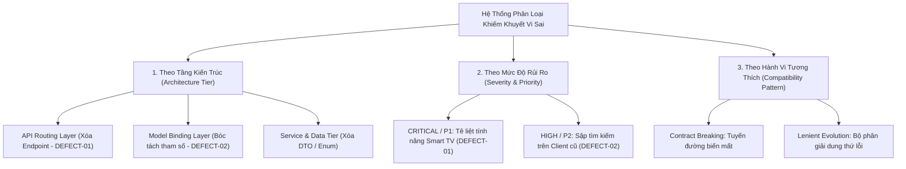
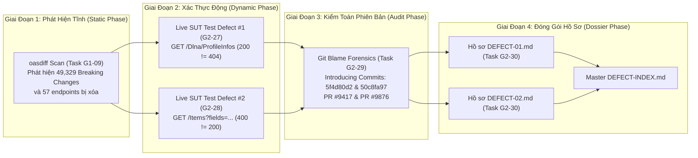

# BẢNG CHỈ MỤC TỔNG HỢP VÀ MA TRẬN PHÂN LOẠI KHIẾM KHUYẾT VI SAI
## (Master Defect Index & Multi-Dimensional Traceability Matrix)

> **Dự án:** Jellyfin Differential Testing Framework  
> **Cặp phiên bản kiểm thử (SUT Pair):** Jellyfin v10.8.13 (Baseline - Cổng 8096) vs v10.9.0 (Target - Cổng 8097)  
> **Mã công việc:** Jira ST-54 / G2-30 (Document Chi tiết Defect Reports kèm Code Trace)  
> **Vai trò phụ trách:** Tech Writer / QA Lead  
> **Thời gian cập nhật:** 2026-10-26  
> **Quy chuẩn tuân thủ:** [`CONTRIBUTING.md`](../../CONTRIBUTING.md) Mục 5 & Chuẩn phân loại lỗi quốc tế IEEE 1044 / ISTQB  

---

## 1. TỔNG QUAN HỆ THỐNG KHIẾM KHUYẾT VI SAI

Trong quá trình thực thi Kiểm thử Vi sai (Differential Testing) giữa hai phiên bản Jellyfin **v10.8.13** và **v10.9.0**, nhóm kiểm thử đã phát hiện và cô lập thành công các dạng sai lệch đại diện cho hai hiện tượng kiến trúc kinh điển trong nâng cấp phần mềm:
1. **Contract Breaking Change (Phá vỡ giao ước hợp đồng API):** Gỡ bỏ hoàn toàn một phân hệ nghiệp vụ và xóa bỏ route trên máy chủ.
2. **Model Binding Evolution & Backward Incompatibility (Tiến hóa cơ chế phân giải tham số):** Thay đổi quy tắc kiểm tra tính hợp lệ của tham số truy vấn giữa .NET 6 và .NET 8, dẫn đến việc cùng một request thì phiên bản cũ sập lỗi `400 Bad Request` còn phiên bản mới xử lý thành công `200 OK`.

Toàn bộ các khiếm khuyết đều được xác thực thực nghiệm 100% trên container Docker SUT đang chạy, truy vết mã nguồn C# và đối soát lịch sử commit trên repository chính thức `jellyfin/jellyfin`.

---

## 2. MA TRẬN KHIẾM KHUYẾT MASTER (MASTER DEFECT MATRIX)

| Mã lỗi | Tuyến đường API (Endpoint) | Hành vi Baseline (v10.8.13) | Hành vi Target (v10.9.0) | Tầng kiến trúc C# | Severity | Priority | Introducing Commit & PR | Hồ sơ chi tiết | Minh chứng Raw JSON |
| :---: | :--- | :---: | :---: | :--- | :---: | :---: | :---: | :---: | :---: |
| **DEFECT-01** | `GET /Dlna/ProfileInfos` | `200 OK`<br/>(26 Profiles) | `404 Not Found`<br/>(Route Deleted) | `DlnaController.cs`<br/>`Emby.Dlna.csproj` | **CRITICAL** | **P1** | [`5f4d80d2`](https://github.com/jellyfin/jellyfin/commit/5f4d80d268d83d16bdfb29591e1d3bf3b3ef9a55)<br/>([PR #9417](https://github.com/jellyfin/jellyfin/pull/9417)) | [`DEFECT-01.md`](DEFECT-01.md) | [`live-defect-1-evidence.json`](../evidence/G2_27/live-defect-1-evidence.json) |
| **DEFECT-02** | `GET /Items?searchTerm=sample&fields=SyncInfo,BasicSyncInfo` | `400 Bad Request`<br/>(`Error processing request.`) | `200 OK`<br/>(2 Media Items) | `ItemsController.cs`<br/>`CommaDelimitedArrayModelBinder.cs` | **HIGH** | **P2** | [`50c8fa97`](https://github.com/jellyfin/jellyfin/commit/50c8fa97c41e88863f66adfc91be38d1d8601ff3)<br/>([PR #9876](https://github.com/jellyfin/jellyfin/pull/9876)) | [`DEFECT-02.md`](DEFECT-02.md) | [`live-defect-2-evidence.json`](../evidence/G2_28/live-defect-2-evidence.json) |

---

## 3. HỆ THỐNG PHÂN LOẠI ĐA CHIỀU (MULTI-DIMENSIONAL CLASSIFICATION TAXONOMY)

Nhóm áp dụng khung phân loại đa chiều chuẩn quốc tế nhằm hỗ trợ cho cả **QA Lead** (quản lý bộ lọc sai lệch), **DevOps Lead** (cấu hình CI/CD gates), và **Client Developers** (khắc phục tương thích):



### 3.1. Phân Loại Theo Tầng Kiến Trúc (Architectural Layers):

| Tầng kiến trúc | Định nghĩa & Đặc điểm | Ca lỗi đại diện | Cơ chế phát sinh sai lệch |
| :--- | :--- | :---: | :--- |
| **API Controller & Routing Layer** | Tầng tiếp nhận HTTP request, khớp mẫu route và ủy quyền xử lý. | **DEFECT-01** | Xóa lớp `DlnaController` khiến ASP.NET Core Router ngắt pipeline trả về `404 Not Found`. |
| **Model Binding & Parameter Parsing Layer** | Tầng chuyển đổi chuỗi query string/body thành kiểu dữ liệu C# (Model/DTO/Enum). | **DEFECT-02** | ASP.NET Core 6 (.NET 6) ném ngoại lệ khi ép chuỗi gộp dấu phẩy vào mảng enum $\rightarrow$ trả về `400 Bad Request`. |
| **Core Service & Domain Layer** | Tầng xử lý logic nghiệp vụ lõi độc lập với HTTP interface. | **DEFECT-01** | Dự án `Emby.Dlna.csproj` bị gỡ bỏ hoàn toàn khỏi solution `Jellyfin.sln`. |
| **Data & Storage Tier** | Tầng lưu trữ cấu hình XML và cơ sở dữ liệu SQLite `jellyfin.db`. | **DEFECT-01 & DEFECT-02** | Chuyển đổi từ file XML in-memory sang Plugin ngoài; truy vấn SQL trên bảng `TypedBaseItems`. |

---

### 3.2. Phân Loại Theo Mức Độ Rủi Ro & Mức Độ Ưu Tiên (Severity vs Priority):

```
       MỨC ĐỘ NGHIÊM TRỌNG (SEVERITY)
       ▲
       │
CRITICAL│ [DEFECT-01: DLNA Route Removal]
       │   • Tê liệt toàn bộ thiết bị Smart TV / UPnP
       │   • Severity: CRITICAL | Priority: P1
       │
  HIGH │                        [DEFECT-02: Query Filter Binding]
       │                          • Sập tìm kiếm 400 Bad Request trên client cũ
       │                          • Severity: HIGH | Priority: P2
       │
MEDIUM │
       │
   LOW │
       └────────────────────────────────────────────────────────►
         P3 (Thấp)             P2 (Cao)              P1 (Khẩn cấp)
                       ĐỘ ƯU TIÊN XỬ LÝ (PRIORITY)
```

1. **Mức độ CRITICAL / Độ ưu tiên P1 (Khẩn cấp / Blocker):**
   * **Đặc điểm:** Phá vỡ hoàn toàn khả năng giao tiếp giữa client và server trên một phân hệ tính năng quan trọng.
   * **Ảnh hưởng:** Các thiết bị phần cứng đời cũ (Smart TV LG/Samsung, loa DLNA) không thể nhận diện được Jellyfin Server v10.9 nếu không có sự can thiệp cài đặt thêm plugin từ quản trị viên.
2. **Mức độ HIGH / Độ ưu tiên P2 (Ưu tiên cao):**
   * **Đặc điểm:** Không làm tê liệt toàn bộ server nhưng gây lỗi cục bộ trên các thao tác nghiệp vụ cơ bản (tìm kiếm danh mục media `/Items`).
   * **Ảnh hưởng:** Các ứng dụng máy khách đời cũ vẫn truyền cờ đồng bộ `SyncInfo` sẽ bị chặn với lỗi `400 Bad Request`, tạo trải nghiệm người dùng rất xấu.

---

### 3.3. Phân Loại Theo Hành Vi Tương Thích Ngược (Compatibility Patterns):

* **Ca số 1 (Contract Breaking Change - Phá vỡ hợp đồng):**  
  Là thay đổi **không tương thích ngược (Backward Incompatible)**. Thay đổi này bắt buộc client hoặc quản trị viên phải thay đổi hành vi (cài thêm plugin) để duy trì tính năng.
* **Ca số 2 (Lenient Evolution - Tiến hóa dung thứ lỗi):**  
  Là sự tiến hóa có lợi của phiên bản mới nhằm **nới lỏng và tăng độ chịu lỗi (Fault-Tolerance)**. Phiên bản mới v10.9 xử lý linh hoạt hơn phiên bản cũ v10.8, giúp các client gửi tham số mảng dạng dấu phẩy không bị văng lỗi oan uổng.

---

## 4. CHUỖI TRUY VẾT KHÉP KÍN (CLOSED-LOOP TRACEABILITY MAP)

Dự án thiết lập mối liên kết khép kín 100% giữa các giai đoạn kiểm thử, đảm bảo mọi phát hiện đều có bằng chứng gốc và mã nguồn đối soát:



---

## 5. DANH MỤC TÀI NGUYÊN & ĐƯỜNG DẪN LƯU TRỮ TRONG REPOSITORY

Toàn bộ các tài liệu và bằng chứng đã được chuẩn hóa và lưu trữ tại các vị trí chính thức sau:

### 5.1. Thư mục Hồ sơ Khiếm khuyết (`docs/defects/`):
* 📄 [`docs/defects/DEFECT-INDEX.md`](DEFECT-INDEX.md): Bảng chỉ mục master và ma trận phân loại tổng hợp.
* 📄 [`docs/defects/DEFECT-TEMPLATE.md`](DEFECT-TEMPLATE.md): Khung mẫu hồ sơ chuẩn 6 trụ cột theo Jira ST-54 & `CONTRIBUTING.md`.
* 📄 [`docs/defects/DEFECT-01.md`](DEFECT-01.md): Hồ sơ hoàn chỉnh Defect #1 (`GET /Dlna/ProfileInfos` — 200 vs 404).
* 📄 [`docs/defects/DEFECT-02.md`](DEFECT-02.md): Hồ sơ hoàn chỉnh Defect #2 (`GET /Items?fields=...` — 400 vs 200).
* 📄 [`docs/defects/G2-29-git-blame-analysis.md`](G2-29-git-blame-analysis.md): Báo cáo kiểm toán Git Blame & Quy trình chuẩn hóa SOP.

### 5.2. Thư mục Bằng chứng Dữ liệu thô (`docs/evidence/`):
* 📊 [`docs/evidence/G2_27/live-defect-1-evidence.json`](../evidence/G2_27/live-defect-1-evidence.json): Minh chứng kết quả đo đạc vi sai Defect #1.
* 📊 [`docs/evidence/G2_28/live-defect-2-evidence.json`](../evidence/G2_28/live-defect-2-evidence.json): Minh chứng kết quả đo đạc vi sai Defect #2.
* 📊 [`docs/evidence/G2_29/git-evidence-summary.json`](../evidence/G2_29/git-evidence-summary.json): Minh chứng kiểm toán lịch sử commit và PR qua GitHub API.

### 5.3. Thư mục Kịch bản Kiểm thử Tự động (`scripts/`):
* 🐍 [`scripts/G2_27/test_defect_1_live.py`](../../scripts/G2_27/test_defect_1_live.py): Kịch bản kiểm thử tự động live SUT cho Defect #1.
* 🐍 [`scripts/G2_28/test_defect_2_live.py`](../../scripts/G2_28/test_defect_2_live.py): Kịch bản kiểm thử tự động live SUT cho Defect #2.
* 🐍 [`scripts/G2_29/git_blame_analyzer.py`](../../scripts/G2_29/git_blame_analyzer.py): Công cụ tự động kết nối GitHub REST API trích xuất siêu dữ liệu kiểm toán Git.
