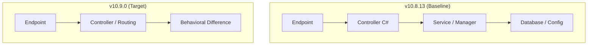

# [MẪU CHUẨN] HỒ SƠ BÁO CÁO DEFECT VI SAI (DIFFERENTIAL DEFECT DOSSIER)
## Tiêu chuẩn 6 Trụ Cột theo Jira ST-54 / G2-30 & CONTRIBUTING.md Section 5

> **Mã lỗi (Defect ID):** `DEFECT-XX`  
> **Jira Task:** ST-XX / G2-XX  
> **Cặp phiên bản kiểm thử (SUT Pair):** Jellyfin v10.8.13 (Baseline - Cổng 8096) vs v10.9.0 (Target - Cổng 8097)  
> **Mức độ nghiêm trọng (Severity):** [CRITICAL / HIGH / MEDIUM / LOW]  
> **Độ ưu tiên xử lý (Priority):** [P1 - Khẩn cấp / P2 - Cao / P3 - Trung bình]  
> **Trạng thái (Status):** [CONFIRMED & ISOLATED ON LIVE SUT]  
> **Người thực hiện:** Tech Writer / QA Engineer  
> **Ngày lập hồ sơ:** YYYY-MM-DD  
> **Minh chứng dữ liệu thô (Raw Evidence):** `docs/evidence/G2_XX/xxx-evidence.json`

---

## 1. MÔ TẢ TỔNG QUAN (EXECUTIVE SUMMARY)
* **Tóm tắt hiện tượng (Symptom):** Mô tả ngắn gọn sự khác biệt vi sai khi gửi cùng 1 request tới 2 phiên bản.
* **Tác động nghiệp vụ (Business Impact):** Ảnh hưởng tới người dùng, ứng dụng khách (Web, Mobile, TV), hoặc hệ thống thứ ba.

---

## 2. CÁC BƯỚC TÁI HIỆN CHI TIẾT (STEPS TO REPRODUCE - PILLAR 1)
* **Điều kiện tiên quyết (Preconditions):**
  1. Hai máy chủ Jellyfin Docker v10.8.13 (`http://localhost:8096`) và v10.9.0 (`http://localhost:8097`) đang chạy.
  2. Tài khoản quản trị `admin` / mật khẩu `admin123456`.
* **Thứ tự thực hiện (Execution Steps):**
  1. **Bước 1:** Gửi request POST `/Users/AuthenticateByName` để lấy `AccessToken`.
  2. **Bước 2:** Đính kèm token vào header xác thực `X-Emby-Token`.
  3. **Bước 3:** Gửi request tới endpoint mục tiêu trên cổng 8096.
  4. **Bước 4:** Gửi cùng request tới endpoint mục tiêu trên cổng 8097.
  5. **Bước 5:** Đối soát HTTP Status Code, Headers và Response Body.

---

## 3. LỆNH cURL TÁI HIỆN ĐỘC LẬP (STANDALONE cURL COMMANDS - PILLAR 2)
*Cung cấp lệnh cURL hoàn chỉnh, độc lập chạy được ngay trên terminal:*

### 3.1. Lệnh cURL gọi Jellyfin v10.8.13 (Baseline - Cổng 8096):
```bash
curl -i -s -X GET "http://localhost:8096/<ENDPOINT>" \
     -H "Accept: application/json" \
     -H "X-Emby-Token: <AUTH_TOKEN_V108>"
```
* **Kết quả trả về:** `HTTP/1.1 <STATUS_CODE>`
* **Payload tóm tắt:** `<JSON_RESPONSE>`

### 3.2. Lệnh cURL gọi Jellyfin v10.9.0 (Target - Cổng 8097):
```bash
curl -i -s -X GET "http://localhost:8097/<ENDPOINT>" \
     -H "Accept: application/json" \
     -H "X-Emby-Token: <AUTH_TOKEN_V109>"
```
* **Kết quả trả về:** `HTTP/1.1 <STATUS_CODE>`
* **Payload tóm tắt:** `<JSON_RESPONSE>`

---

## 4. NHẬT KÝ ĐỐI SOÁT VI SAI (DIFFERENTIAL ENGINE DIFF LOG - PILLAR 3)
```text
================================================================================
  DIFFERENTIAL COMPARATOR LOG - DEFECT #XX
================================================================================
  Target Endpoint   : <METHOD> <PATH>
  Authentication    : Bearer X-Emby-Token
--------------------------------------------------------------------------------
  [LEVEL 1: HTTP STATUS CODE] -> DIVERGENCE DETECTED ❌
    - Baseline (v10.8.13) : <STATUS_108>
    - Target   (v10.9.0)  : <STATUS_109>
    - Result              : FAIL (Mismatch: <STATUS_108> != <STATUS_109>)

  [LEVEL 2: RESPONSE HEADERS]
    - Baseline (v10.8.13) : Content-Type: ...
    - Target   (v10.9.0)  : Content-Type: ...

  [LEVEL 3: JSON BODY SEMANTIC DIFF]
    - Baseline vs Target  : <CHI TIẾT SAI LỆCH SCHEMA HOẶC DỮ LIỆU>
================================================================================
```
* **File bằng chứng dữ liệu thô:** Link đến `docs/evidence/G2_XX/xxx-evidence.json`.

---

## 5. TRUY VẾT MÃ NGUỒN C# (C# SOURCE CODE TRACE - PILLAR 4)



### 5.1. Tầng Controller (`Jellyfin.Api`)
* Phân tích file Controller, route attribute, action method và model binding.

### 5.2. Tầng Dịch vụ Lõi (`MediaBrowser.Controller` / Service)
* Phân tích interface, implementation class và logic nghiệp vụ.

### 5.3. Tầng Dữ liệu / Cấu hình (`EF Core / SQLite / XML`)
* Phân tích truy vấn SQLite, bảng dữ liệu hoặc in-memory state.

---

## 6. MINH CHỨNG KIỂM TOÁN PHIÊN BẢN (GIT EVIDENCE & AUDIT TRAIL - PILLAR 5)

| Thuộc tính kiểm toán | Chi tiết dữ liệu trên upstream `jellyfin/jellyfin` |
| :--- | :--- |
| **Introducing Commit SHA** | `<FULL_COMMIT_SHA>` ([Xem Permalink trên GitHub](https://github.com/jellyfin/jellyfin/commit/<SHA>)) |
| **Pull Request liên kết** | [PR #XXXX: <Tiêu đề PR>](https://github.com/jellyfin/jellyfin/pull/XXXX) |
| **Tác giả & Người duyệt** | Author: `<Tác_giả>` | Merged by: `<Người_duyệt>` |
| **Thời gian merge** | `YYYY-MM-DDTHH:MM:SSZ` |
| **Thống kê Git Diff** | XX files changed, +X insertions, -Y deletions |
| **Lệnh Git tái hiện** | `git log -S "<TỪ_KHÓA>" -- "<FILE_PATH>"` |
| **Bằng chứng máy đọc được** | `docs/evidence/G2_29/git-evidence-summary.json` |

---

## 7. PHÂN LOẠI KHIẾM KHUYẾT & ĐÁNH GIÁ RỦI RO (CLASSIFICATION & RISK - PILLAR 6)

### 7.1. Bảng Phân Loại Chuẩn (Classification Taxonomy)
* **Phân loại khiếm khuyết (Defect Classification):** [Contract Breaking Change / Removed Route / Model Binding Drift / Behavioral Change]
* **Tầng kiến trúc chịu lỗi (Architectural Layer):** [API Controller / Core Service / Database / Infrastructure]
* **Mức độ nghiêm trọng (Severity):** [CRITICAL / HIGH / MEDIUM / LOW]
* **Mức độ ưu tiên xử lý (Priority):** [P1 / P2 / P3]

### 7.2. Đánh Giá Tác Động Ứng Dụng Khách (Client Impact Analysis)
* Phân tích ảnh hưởng cụ thể tới Jellyfin Web, Mobile App (Android/iOS), Android TV, Smart TV, VLC/Kodi.

### 7.3. Khuyến Nghị & Giải Pháp Giảm Thiểu (Mitigation & Workaround)
* Hướng dẫn dành cho Client Developers và System Administrators để xử lý hoặc vượt qua lỗi.
