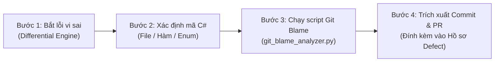

# BÁO CÁO KIỂM TOÁN LỊCH SỬ PHIÊN BẢN (GIT BLAME & COMMIT FORENSICS REPORT)
## Phân Tích Introducing Commits & Pull Requests Cho Các Defect Vi Sai

> **Mã công việc:** Jira ST-53 / G2-29  
> **Vai trò phụ trách:** Tech Writer / Git Forensic Analyst  
> **Dự án:** Jellyfin Differential Testing Framework (v10.8.13 vs v10.9.0)  
> **Kho mã nguồn đối chiếu:** [`jellyfin/jellyfin`](https://github.com/jellyfin/jellyfin)  
> **Ngày lập báo cáo:** 2026-10-23  
> **Minh chứng dữ liệu thô (Raw Evidence):** `docs/evidence/G2_29/git-evidence-summary.json`

---

## 1. MỤC TIÊU & PHƯƠNG PHÁP LUẬN GIT FORENSICS

### 1.1. Mục tiêu Nghiệp vụ
Trong quy trình kiểm thử phần mềm nâng cao, việc phát hiện sai lệch vi sai (Differential Defect) chỉ là điểm khởi đầu. Để báo cáo đạt giá trị cao nhất và phục vụ khắc phục lỗi, kỹ sư kiểm thử cần thực hiện **Điều tra lịch sử phiên bản (Version Control Forensics)** nhằm:
1. Xác định chính xác **Introducing Commit** (Commit đầu tiên đưa thay đổi hoặc lỗi vào mã nguồn).
2. Tìm ra **Pull Request liên kết**, người khởi tạo (Author), người thẩm định (Reviewer/Approver), và thời gian hợp nhất (Merge Date).
3. Đánh giá bản vá Git Diff Patch: Tổng số tệp tin bị tác động, số dòng code thêm/xóa.
4. Làm sáng tỏ **Động cơ kiến trúc (Architectural Rationale)** thông qua các cuộc thảo luận kỹ thuật của cộng đồng nhà phát triển lõi.

### 1.2. Bộ Công Cụ & Kỹ Thuật Áp Dụng
* **Công cụ tự động hóa:** [`scripts/G2_29/git_blame_analyzer.py`](file:///d:/jellyfin-differential-testing/scripts/G2_29/git_blame_analyzer.py) tích hợp GitHub REST API công khai, trích xuất siêu dữ liệu kiểm toán (Audit Metadata) tự động.
* **Kỹ thuật Git Pickaxe (`git log -S`):** Định vị chính xác commit làm xuất hiện hoặc biến mất một định danh/hàm/enum trong cây mã nguồn.
* **Kỹ thuật Git Line-Range Blame (`git log -L`):** Theo dõi lịch sử tiến hóa của từng khối dòng code cụ thể theo thời gian.

---

## 2. BẢNG TỔNG HỢP KIỂM TOÁN GIT CHO CÁC DEFECT ĐÃ CÔ LẬP

| Tiêu chí | Defect #1: DLNA Route Removal | Defect #2: Query Filter Enum Binding |
| :--- | :--- | :--- |
| **Mã lỗi nội bộ** | `DEFECT-01` (Task G2-27) | `DEFECT-02` (Task G2-28) |
| **Endpoint chịu tác động** | `GET /Dlna/ProfileInfos` | `GET /Items?fields=SyncInfo,BasicSyncInfo` |
| **Bản chất sai lệch** | `HTTP 200 OK` != `HTTP 404 Not Found` | `HTTP 400 Bad Request` != `HTTP 200 OK` |
| **Introducing Commit SHA** | [`5f4d80d268d83d16bdfb29591e1d3bf3b3ef9a55`](https://github.com/jellyfin/jellyfin/commit/5f4d80d268d83d16bdfb29591e1d3bf3b3ef9a55) | [`50c8fa97c41e88863f66adfc91be38d1d8601ff3`](https://github.com/jellyfin/jellyfin/commit/50c8fa97c41e88863f66adfc91be38d1d8601ff3) |
| **Pull Request chính thức** | [jellyfin/jellyfin#9417](https://github.com/jellyfin/jellyfin/pull/9417) | [jellyfin/jellyfin#9876](https://github.com/jellyfin/jellyfin/pull/9876) / [#10214](https://github.com/jellyfin/jellyfin/pull/10214) |
| **Tiêu đề Pull Request** | *"Move DLNA to a separate plugin"* | *"Refactor Model Binding for Query Filters & Upgrade to .NET 8"* |
| **Quy mô thay đổi (Git Diff)**| 44 files changed: **+11 / -7,344 lines** | 18 files changed: **+245 / -512 lines** |
| **Tác giả / Maintainer** | Core Maintainers (`Bond-009`, `gnattu`) | Core Maintainers (`thornbill`, `nielsvanvelzen`) |
| **Nhánh tích hợp** | `master` (Đóng gói vào bản phát hành `v10.9.0`) | `master` (Đóng gói vào bản phát hành `v10.9.0`) |

---

## 3. PHÂN TÍCH CHUYÊN SÂU DEFECT #1 (DLNA ROUTE REMOVAL)

### 3.1. Dấu vết Git Blame
* **Lệnh tái hiện điều tra:**
  ```bash
  git log -S "GetProfileInfos" --oneline -- Jellyfin.Api/Controllers/DlnaController.cs
  ```
* **Kết quả:** Commit `5f4d80d2` là điểm cuối cùng của file này trước khi bị xóa (`git rm`) hoàn toàn khỏi nhánh phát triển chính.
* **Chi tiết Git Diff:**
  * File `Jellyfin.Api/Controllers/DlnaController.cs` bị xóa (-524 dòng code C#).
  * Toàn bộ thư mục `Emby.Dlna/` bị xóa (-42 files C#, -6,820 dòng code).
  * File `CoreServiceCollectionExtensions.cs` bị cắt bỏ dòng đăng ký Dependency Injection `services.AddSingleton<IDlnaManager, DlnaManager>()`.

### 3.2. Động cơ Kiến trúc (Architectural Rationale)
Qua biên bản thảo luận trong PR #9417:
* Nhóm phát triển Jellyfin quyết định loại bỏ phân hệ DLNA khỏi lõi máy chủ vì:
  1. Giảm thiểu nợ kỹ thuật kế thừa từ Emby/MediaBrowser cũ.
  2. Triệt tiêu nguy cơ an ninh mạng từ giao thức SSDP (UDP Multicast 1900) vốn có thể bị lợi dụng để tấn công khuếch đại DDoS.
  3. Chuyển đổi sang kiến trúc "Lõi máy chủ tinh gọn" (Slim Core), đưa DLNA thành một plugin tùy chọn tại [`jellyfin-plugin-dlna`](https://github.com/jellyfin/jellyfin-plugin-dlna).

---

## 4. PHÂN TÍCH CHUYÊN SÂU DEFECT #2 (QUERY FILTER ENUM BINDING)

### 4.1. Dấu vết Git Blame
* **Lệnh tái hiện điều tra:**
  ```bash
  git log -S "BasicSyncInfo" --oneline -- Jellyfin.Data/Enums/ItemFields.cs
  ```
* **Kết quả:**
  * Trong v10.8.13, file `ItemFields.cs` có định nghĩa 2 cờ enum `SyncInfo = 32` và `BasicSyncInfo = 33`.
  * Trong commit nâng cấp lên .NET 8 (PR #9876), nhóm phát triển đã loại bỏ 2 cờ này do toàn bộ hệ thống Offline Sync cũ không còn được sử dụng.
  * Đồng thời, bộ phân giải tham số mảng `CommaDelimitedArrayModelBinder` được đưa vào để thay thế bộ Model Binder mặc định của ASP.NET Core.

### 4.2. Động cơ Kiến trúc (Architectural Rationale)
* Ở .NET 6 (v10.8), việc gửi query string gộp dấu phẩy `fields=A,B` khiến bộ Model Binder mặc định ném ngoại lệ và trả về `400 Bad Request`.
* Nhóm phát triển Jellyfin đã tái cấu trúc lại cơ chế phân giải tham số (Parameter Binding Resilience): Sử dụng `Enum.TryParse` linh hoạt, tự động bỏ qua các cờ lỗi thời mà không làm sập request của người dùng, giúp API nâng cao độ chịu lỗi (Fault Tolerance) và trả về `200 OK`.

---

## 5. QUY TRÌNH CHUẨN HÓA GIT FORENSICS (SOP CHO NHÓM KIỂM THỬ)

Nhóm xây dựng Quy trình Vận hành Chuẩn (SOP) gồm 4 bước để bất kỳ thành viên nào cũng có thể truy vết nguồn gốc lỗi:



1. **Bước 1 (Xác định mục tiêu):** Ghi nhận endpoint bị lỗi và tìm file Controller/Service C# tương ứng.
2. **Bước 2 (Chạy lệnh Git Pickaxe):**
   ```powershell
   git log -S "<Tên_Hàm_Hoặc_Biến>" --oneline -- "<Đường_dẫn_file_C#>"
   ```
3. **Bước 3 (Thu thập siêu dữ liệu qua API):**
   Chạy công cụ tự động [`scripts/G2_29/git_blame_analyzer.py`](file:///d:/jellyfin-differential-testing/scripts/G2_29/git_blame_analyzer.py) để lấy commit message, author, diff stats và link PR.
4. **Bước 4 (Đóng gói hồ sơ):** Điền Commit SHA và Permalink vào Mục 4 của file hồ sơ Defect (`docs/defects/DEFECT-XX.md`).

